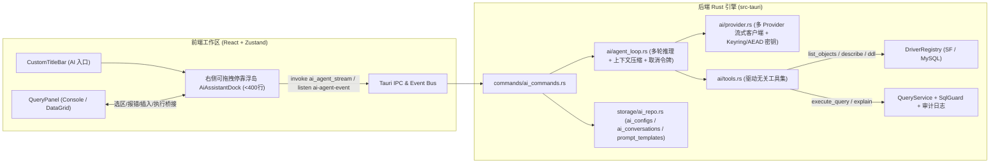

# AI 助手重构调研与集成方案报告（参考 `dbx`）

> 编制日期：2026-11-26  
> 调研基准：`d:\test-workspace\dbx`（参考实现）与 `d:\test-workspace\simple-salesforce-tool`（当前项目）  
> 约束基准：[AGENTS.md](file:///d:/test-workspace/simple-salesforce-tool/AGENTS.md)

---

## 一、`dbx` AI 助手实现架构调研

`dbx` 将 AI 助手定位为**具备多模型接入、真实数据库工具调用（Tool Calling）、上下文压缩、写操作安全门禁与编辑器深度联动**的自治 Agent 工作台，核心拆分为 Rust 引擎层（`crates/dbx-core`）、Tauri 命令层（`src-tauri/src/commands`）与前端交互层（`apps/desktop/src`）。

### 1.1 后端核心设计（Rust）

| 模块 | 文件路径 | 核心职责与关键实现 |
| --- | --- | --- |
| **Provider 与流控** | `crates/dbx-core/src/ai.rs` | 定义 `AiProvider`（10 种 HTTP API + 8 种本地 CLI Agent）、`AiApiStyle`（`Completions` / `Responses` / `AnthropicMessages`）、`AiReasoningLevel` / `AiEffortCapability`；维护全局流取消表 `AI_STREAMS: LazyLock<RwLock<HashMap<String, Arc<Notify>>>>`，支持按 `session_id` 随时中断流与子进程。 |
| **Agent 循环引擎** | `crates/dbx-core/src/agent_loop.rs` | `run_agent_loop` 驱动多轮推理（默认 `DEFAULT_MAX_AGENT_TURNS = 30`，上限 `500`）；内置 `maybe_compact` 在超上下文预算或命中长度错误时自动摘要压缩历史并保证 `tool_use`/`tool_result` 配对完整性；按 `ToolDefinition.parallel_ok` 区分并发（`join_all`）与串行工具执行；通过 `validate_final_answer` 对输出做任务契约校验与最多 2 次自修复。 |
| **工具集与安全门禁** | `crates/dbx-core/src/agent_tools.rs` | 区分 **Ask 模式**（`read_only_tools`：`list_tables`、`get_columns`、`get_current_time`）与 **Agent 模式**（`all_tools`：追加 `execute_query`、`get_sample_data`、`explain_query`）。 **Fail-Closed 写门禁**：`verify_confirmed_target` 校验确认快照（连接/库/Schema）是否一致；生产库（`is_production_database`）永不授予写权限；未确认的写/DDL 在分发前被 `unconfirmed_write_sql` 拦截并发出 `WriteSqlConfirmationRequired` / `ProductionWriteBlocked` 事件。 |
| **流式事件协议** | `crates/dbx-core/src/agent_events.rs` | 定义 `AgentEvent` 枚举：`TurnStart`、`TurnEnd`、`TextDelta`、`ReasoningDelta`、`ToolCallStart`、`ToolCallEnd`、`WriteSqlConfirmationRequired`、`ProductionWriteBlocked`、`ResponseComplete`、`AgentEnd`、`ContextCompacted`、`Error`。通过 Tauri `ai-agent-event` 事件实时推送至前端。 |
| **持久化层** | `crates/dbx-core/src/storage.rs` | SQLite 持久化多配置表 `ai_configs`（含 `is_default` 唯一索引）、会话表 `ai_conversations`、提示词模板表 `prompt_templates` 及 `app_state` 偏好键值。 |

### 1.2 前端核心设计（`apps/desktop/src`）

1. **停靠与工作流联动（`App.vue` + `AiAssistant.vue`）**：
   - 右侧可拖拽调宽且支持一键最大化的停靠面板；顶部支持切换连接与数据库/Schema，带生产环境视觉标识。
   - **双向联动**（不额外做遮挡编辑器的 Inline 浮窗）：
     - **编辑器 → AI**：选中 SQL 发送到 AI（`sendSelectionToAi`）、查询报错一键修复（`fixWithAi`）、历史 SQL 分析、侧边栏表/字段 `@table` 引用与拖拽注入。
     - **AI → 编辑器**：一键替换/追加到编辑器（`@replace-sql`）、追加并执行（`@execute-sql`）、临时运行不改编辑器（`@temp-run-sql`）、执行计划可视化弹窗（`ExplainPlanViewer.vue`）。
2. **双模式 + 技能体系（`lib/ai/aiSkills.ts`）**：
   - `ask` 模式：`general` / `generate` / `explain` / `optimize` / `fix` / `convert` / `sampleData`（只读，安全问答与代码生成）。
   - `agent` 模式：`general` / `query` / `exploreSchema` / `executeAndExplain` / `generate`（可自主查 Schema、采样数据、执行只读查询、分析执行计划并迭代修正）。
3. **流式渲染与竞态防护**：
   - `AiGenerationGuard` 代际锁防止切换会话或新建请求时旧流回写污染 UI。
   - `requestAnimationFrame` 合批刷新 `TextDelta` / `ReasoningDelta`，降低 Markdown + Shiki 高亮重排开销。
   - `aiAgentStepPresentation.ts` 展示可折叠的工具调用步骤、入参/出参与耗时；`writeSqlConfirmation` 卡片提供“确认执行”交互。

---

## 二、当前项目（`simple-salesforce-tool`）现状与集成缺口

### 2.1 现有资产盘点

| 层级 | 现有文件 | 现状评估 |
| --- | --- | --- |
| **后端编排** | [orchestrator.rs](file:///d:/test-workspace/simple-salesforce-tool/src-tauri/src/ai/orchestrator.rs) | 基于 `rig`（`openai::Client`）实现单轮同步调用；**无流式输出**、**无上下文压缩**、**无真实工具调用追踪**；系统提示词与意图门控硬编码为 **Salesforce SOQL 专用且仅允许 SELECT**；会话历史仅存内存 `AppState.llm_conversations`（重启丢失）。 |
| **后端工具** | [tools.rs](file:///d:/test-workspace/simple-salesforce-tool/src-tauri/src/ai/tools.rs) | 仅提供 5 个 Salesforce 元数据工具（`find_salesforce_objects` 等），缺少关系型 DDL 查询、样本数据读取、受控 SQL 执行与 `EXPLAIN` 工具。 |
| **命令与存储** | [ai_commands.rs](file:///d:/test-workspace/simple-salesforce-tool/src-tauri/src/commands/ai_commands.rs) | 已注册 `get_llm_settings` / `save_llm_settings` / `ai_chat_turn_v2` / `ai_stop_turn` 等；但 **`api_key` 明文存入 `app_settings`**（违反 `AGENTS.md` 安全约束），且 `stop` 标志未接入真实请求中断。 |
| **前端设置与入口** | [LlmSettingsSection.tsx](file:///d:/test-workspace/simple-salesforce-tool/src/features/settings/sections/LlmSettingsSection.tsx)、[MainPage.tsx](file:///d:/test-workspace/simple-salesforce-tool/src/pages/MainPage.tsx) | 设置页已具备 Base URL / Model / API Key 基础表单；顶部标题栏已有“AI 助手”开关与右侧 `320px` 停靠位；但 **UI 面板完全缺失**，`useSoqlExecutorStore.ts` 中残留未消费的 `aiMessages` 等字段。 |

### 2.2 必须遵守的架构约束与核心缺口（对照 `AGENTS.md`）

1. **多数据源抽象约束（严禁硬编码分支）**：
   - 当前 AI 模块假设所有数据源都是 Salesforce SOQL，无法服务 MySQL（及未来扩展的 Postgres/SQLite 等驱动）。
   - **解法**：后端通过 `DriverRegistry` 读取 `DataSourceDriver.capabilities()`（`query_language`、`supports_ddl`、`supports_explain`），动态向 Agent 注入适配当前数据源语言的系统提示词与工具集；前端通过 `getDataSourceDriver(sourceType)` 获取能力矩阵。
2. **凭证安全与 SQLite 增量迁移约束**：
   - `api_key` 必须通过 `services/secret_service.rs` + `storage/secret_crypto.rs`（Keyring + AEAD）加密存储，清理 `app_settings` 明文保存。
   - 新增的 `ai_configs`、`ai_conversations`、`ai_prompt_templates` 表必须通过 `MigrationRunner` 增量迁移脚本创建。
3. **SqlGuard 安全网关与审计生命线**：
   - Agent 的 `execute_query` 工具不能绕过现有安全链路直接裸连数据库，必须统一复用 `QueryService` / `evaluate_sql_safety`（`SqlGuard`）与 `sql_execution_audit` 审计表；触发 `RequireConfirmation` 时转为前端确认卡片（对应 `dbx` 的 `WriteSqlConfirmationRequired`）。
4. **前端单文件体量与状态隔离约束**：
   - `dbx` 的 `AiAssistant.vue` 单文件高达 4234 行，在本项目中**严禁**复刻巨型 God File，必须拆分为 `<400` 行的容器组件、消息列表、输入框/引用选择器、工具步骤卡片与状态 Store。
   - 补全 `MainPage.tsx` 与 `QueryPanel` 的编辑器桥接（读取当前激活控制台的选区、草稿、报错信息、绑定数据源，并支持写回当前 Tab / 新建 Tab / 一键执行）。

---

## 三、集成方案设计：AI 助手提供的能力与业务价值

### 3.1 核心能力矩阵（融合 `dbx` 能力与当前多数据源特性）

| 能力域 | 具体功能 | 业务价值 |
| --- | --- | --- |
| **跨源自然语言查数（Ask / Agent）** | 支持 **Salesforce SOQL** 与 **MySQL SQL** 双语境。Ask 模式只读生成与解释；Agent 模式自主调用元数据和查询工具验证字段名、关联关系并直接返回结果摘要。 | 消除跨 Salesforce 对象（`__r` 关联字段）与 MySQL 表结构的记忆负担，减少拼写与方言报错。 |
| **Schema 感知与 `@` 上下文引用** | 支持 `@表/对象` 自动补全、发送编辑器选中片段、注入当前激活对象/表的元数据与 DDL。 | 避免大模型幻觉编造不存在的字段或关联路径，生成即用型精确查询。 |
| **报错一键诊断与修复（Fix with AI）** | 控制台日志报错旁提供“AI 修复”入口，自动打包失败 SQL + 错误堆栈 + 关联表结构发往 AI，返回修复后语句并支持一键替换运行。 | 将排查语法、权限、字段类型不匹配的时间从分钟级压缩到秒级。 |
| **执行计划与 SQL 优化** | Agent 可调用 `explain_query`（在 `supports_explain` 驱动上）解读索引命中与全表扫描瓶颈，提出索引或重写建议。 | 直接提升生产与测试环境复杂 SQL 调优效率。 |
| **安全可控的写操作闭环** | 只读数据源硬拦截；生产环境默认禁止 Agent 自动写入；非生产写/DDL 必须经过 `SqlGuard` 判定并通过交互卡片二次确认，全程记入 `sql_execution_audit`。 | 兼顾 Agent 自动化效率与企业级数据安全合规。 |
| **多模型配置与流式体验** | 支持多套 LLM 配置切换（OpenAI 兼容 / Anthropic / DeepSeek / Ollama 等）、Tauri 事件流式打字机输出、随时停止生成与会话历史持久化。 | 支持团队/个人按场景切换成本与能力模型，重启不丢失分析上下文。 |

### 3.2 推荐总体架构图

---

## 四、分阶段重构实施计划

### Phase 1：基础设施与安全合规改造（后端底座）
1. **SQLite 增量迁移**：在 `MigrationRunner` 新增迁移版本，创建 `ai_configs`、`ai_conversations`、`ai_prompt_templates` 表。
2. **密钥安全化**：重构 `ai_commands.rs` / `LlmSettings`，通过 `secret_service` + `secret_crypto` 加密存储各配置 `api_key`，移除 `app_settings` 明文保存。
3. **多 Provider 流式引擎与取消机制**：参考 `dbx-core/src/ai.rs`，实现支持 OpenAI / Anthropic / DeepSeek / Ollama 等兼容端点的流式请求客户端与 `AI_STREAMS` 取消注册表（真正打通 `ai_stop_turn`）。

### Phase 2：Agent 循环引擎与驱动无关工具集（核心智能）
1. **定义 `AgentEvent` 事件模型**：统一发射 `turn_start`、`text_delta`、`reasoning_delta`、`tool_call_start`、`tool_call_end`、`write_sql_confirmation_required`、`context_compacted`、`agent_end`、`error`。
2. **重构 `agent_loop.rs`**：实现多轮工具调用、Token 预算估算与 `maybe_compact` 历史压缩、并发/串行工具拆分以及最终结果契约校验。
3. **重构 `tools.rs`（去 Salesforce 硬编码）**：
   - 基于 `DriverRegistry` 动态声明工具集：`list_objects`、`describe_object`、`get_object_ddl`（按 `supports_ddl` 暴露）、`get_sample_data`、`execute_query`（严格经由 `QueryService` + `SqlGuard` 执行并写入 `sql_execution_audit`）、`explain_query`（按 `supports_explain` 暴露）。
   - 对接 `SqlGuard` 的 `RequireConfirmation` 返回结果，向前端发出确认卡片事件。

### Phase 3：前端 AI 助手面板与工作区深度集成（用户价值交付）
1. **停靠容器与模块化组件（`src/features/ai/`）**：
   - 将主面板从 `MainPage.tsx` 的硬编码 `320px` 升级为基于 `SplitPaneLayout` 的可调宽（含拖拽与最大化）右侧停靠工作台。
   - 按职责拆分为：`AiAssistantPanel.tsx`、`AiMessageList.tsx`、`AiToolStepsCard.tsx`、`AiPromptInput.tsx`（含 `@对象/表` 补全与 Ask/Agent 模式/技能切换）、`AiConversationDrawer.tsx`、`useAiStore.ts`。
2. **流式渲染与防竞态**：接入 `rAF` 帧合批与 `AiGenerationGuard` 代际校验；复用项目已有 Markdown/代码高亮能力渲染 SQL/SOQL 代码块。
3. **编辑器与工作区双向联动**：
   - 补全工作区上下文桥接：AI 可读取当前激活控制台的绑定数据源、方言、草稿、选区与最近错误；
   - 消息卡片提供「替换到当前控制台」「新建控制台打开」「直接执行（走 SqlGuard）」按钮；
   - 在控制台日志报错区与编辑器右键菜单补充「发送给 AI / AI 修复」入口。

### Phase 4：多模型配置 UI、提示词模板与回归验证
1. 升级设置页 [LlmSettingsSection.tsx](file:///d:/test-workspace/simple-salesforce-tool/src/features/settings/sections/LlmSettingsSection.tsx) 为多配置管理（新增、测试连接、设为默认、超时与 Provider 选择）。
2. 补充自定义 Prompt 模板与全局自定义指令配置。
3. 编写 Rust 单元测试（`agent_loop` 上下文压缩、工具权限与 `SqlGuard` 联动拦截、加密存储）与前端单测（流式状态机、代际守卫、`@` 引用解析）。
